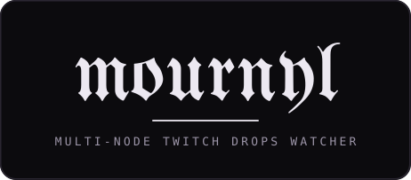

<div align="center">



&nbsp;


**A multi-account Twitch drops watcher with a desktop UI.**
Each account runs as its own node, optionally through its own proxy.

</div>

---

## Features

- **Multi-account** — one node per account, all visible on a Home page: state, network route, channel, drop progress and credited minutes
- **Games-to-mine list** — set the games on the Home page; every node mines them in order, holding each at least an hour before moving on
- **Drops at a glance** — a Drops tab showing every node and the drop it's working on
- **Target-game lock** — a node leaves a channel when the stream ends or the streamer switches game, and never follows a raid or host
- **Channel override** — point one node, or all of them, at a specific channel
- **Auto-claim** — finished drops claim themselves (on by default), with manual claim buttons too
- **Your own proxies** — import, test and assign a proxy per account in their own tab, with automatic failover
- **Reward pictures** — each drop shows its reward image

## Download (Windows)

1. Grab the latest **`mournyl-miner-windows.zip`** from the [Releases](../../releases) page.
2. Unzip it anywhere, keeping **`mournylTwitchMiner.exe`** and the **`fonts`** folder together.
3. Run **`mournylTwitchMiner.exe`**.

On first launch the app creates a `data` folder next to the exe for your accounts.

> [!NOTE]
> The exe isn't code-signed, so Windows may warn that the publisher is unverified. If you see **SmartScreen**, click **More info → Run anyway**. If **Smart App Control** blocks it (some fresh Windows 11 installs), run from source instead — see below.

## Run from source

Works on any OS with Python 3.10+ and sidesteps the Windows warnings.

```bash
pip install -r requirements.txt
python app.py
```

Adding accounts (either way): click **+ Add account** and approve the Twitch device-code login in your browser.

## Data

> [!WARNING]
> Everything the app saves lives in a `data/` folder next to the app — account **tokens**, cookies, proxies, settings and logs.
> It's in `.gitignore`; never commit or share it. Those tokens give full access to the accounts.

## Fonts

Bundled in `fonts/` under the SIL Open Font License (UnifrakturMaguntia, IBM Plex Sans, IBM Plex Mono). See [`fonts/README.md`](fonts/README.md).

## Disclaimer

Not affiliated with Twitch. Automated viewing and running multiple accounts may violate Twitch's Terms of Service — use at your own risk.
